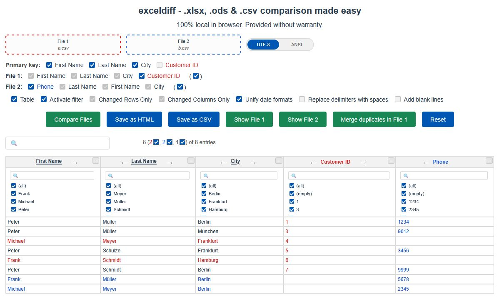

# exceldiff 📊

> **Lightweight, 100% local spreadsheet comparison directly in your browser.**

`exceldiff` runs entirely on the client side to quickly compare two `.xlsx`, `.ods`, `.csv`, or `.txt` files based on primary keys. No server, no installation, maximum privacy.

🌐 **Available Versions:** [`exceldiff.html` (English)](exceldiff.html) | [`exceldiff-de.html` (Deutsch)](exceldiff-de.html)

*Note: The respective language is pre-configured in each file at `class App static Config`. You can easily add and contribute new languages in the code inside `class App static Translations`.*

---

---

## 🔒 100% Local, Private & Secure

Because `exceldiff` is a single, self-contained HTML/CSS/JavaScript file, it requires no installation or backend server.

* **Run Anywhere, 100% Offline:** Launch the app instantly on any device with a web browser—no internet connection, no local setup, and no server configuration required.
* **No Server Uploads:** Your sensitive spreadsheet data never leaves your computer. All calculations and comparison processes are executed purely within your browser's local memory.
* **No Third-Party CDNs:** All required JavaScript libraries (read-excel-file, PapaParse, fflate, tXml) are bundled directly within the HTML source code. No external scripts or resources are loaded (100% offline-ready).
* **No Cookies or Tracking:** No tracking scripts, no cookies, and absolutely no web analytics.

---

## ✨ Features

- **Multi-Format Support:** Compare `.xlsx` (Excel), `.ods` (OpenDocument), `.csv`, and `.txt` files.
- **Flexible Encoding & Delimiters:** Swap between UTF-8 and ANSI encoding, and handle custom column delimiters.
- **Flexible Delimiter Settings:** Delimiters are customizable in the code, or you can easily disable/replace them directly during runtime.
- **Robust Data Validation:** Automatically checks for structural issues such as mismatched columns, duplicate headers, empty keys, ...
- **Smart Key Detection:** Automatically detects the best possible primary key (including composite keys) upon loading your files.
- **Duplicate Clean-up:** Consolidate duplicates in your first file using adjustable delimiter symbols.
- **Date Standardization:** Optionally auto-detect and unify various date formats (e.g., `DD.MM.YYYY` or `MM/DD/YYYY` into `YYYY-MM-DD`).
- **Dual Presentation Modes:** Toggle between a structured, interactive table grid and a raw text view.
- **High-Performance Virtual Scrolling:** Smoothly handle and scroll through huge datasets by rendering only visible elements in the browser.
- **Dynamic Column Widths:** Columns automatically adjust to their content featuring smart limits.
- **Visual Differences:** Modifications, added rows, and deleted entries are clearly highlighted using intuitive color schemes.
- **Row & Column Highlighting:** Double-click any row or column to highlight it for better visual guidance.
- **Interactive Column Handling:** Move columns on the fly (← →), toggle their visibility (− / +), or sort them directly in the browser.
- **Filtering & Search:** Built-in live search and dynamic, searchable column dropdown filters to handle large datasets easily.
- **HTML Export:** Exported comparison results remain fully interactive—including search, sorting, column rearranging, and filtering directly within the exported file.
- **CSV Export:** Fast and clean export of your cleaned text or CSV data.
- **Multi-Language Support:** Fully supports English and German interfaces and is easily extensible for other languages.

---

## 📦 Bundled Libraries & Licenses

This project uses the following open-source libraries (each under an MIT License), which are integrated directly at the end of the source code:

1. **[read-excel-file](https://gitlab.com/catamphetamine/read-excel-file)** (v9.x) – For reading Excel spreadsheets.
2. **[PapaParse](https://github.com/mholt/PapaParse)** (v5.4.1) – For fast parsing of CSV and text files.
3. **[fflate](https://github.com/101arrowz/fflate)** (v0.8.3) – For decompressing `.ods` archives.
4. **[tXml](https://github.com/TobiasNickel/tXml)** (v6.0.0) – For parsing XML contents within ODS files.

---

## 📄 License

This project is licensed under the **MIT License**. You can find the licensing details in the `LICENSE` file.
